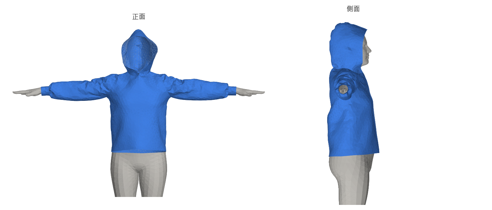
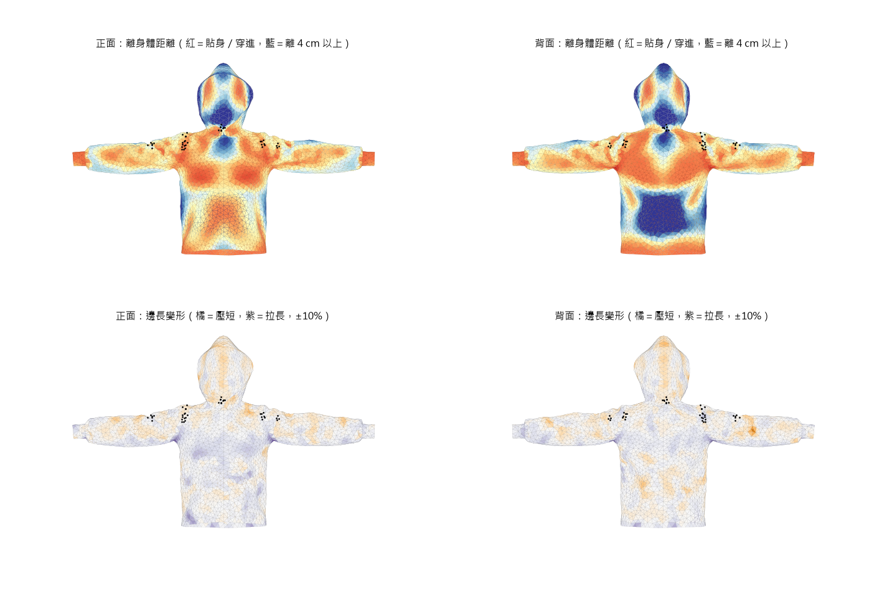
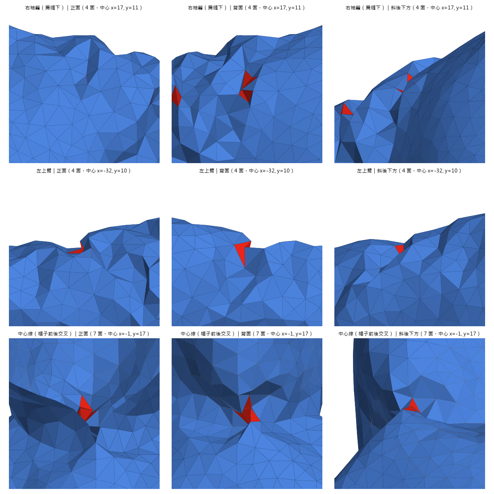

# 問紀泓宇：新版衣物網格交給 engine 前要確認的事

> 📅 2026-11-07
> 💻 網格：`flows/body_fit/export_neutral.py` 匯出的 g03 藍帽 T（SMPL-X 中性、θ=0、β 全 0，T-pose）
> 📖 已先讀過 `VTO_PROJ` 的 `engine/README.md`、`engine/cloth/spec.py`、`engine/metrics/spec.py`、`engine/cloth/garment_io.py`、`engine/cloth/garments.py`、`Complete_System/系統對照.md`（2026-10-28 版）

---

## 一、這次交的網格長怎樣

| 項目 | g03 藍帽 T（新） | e16 黑色帽 T（engine 現在用的） |
|---|---|---|
| 縫衣服用的身體 | SMPL-X 中性（mean_all 尺寸檔） | SMPL 女性模板 |
| 座標 | **SMPL-X 原始座標**，不用平移對齊 | 用肩頂平移到 SMPL-X |
| 頂點間距 | 2 cm | 2 cm |
| 頂點／面 | 3,441／6,770 | 2,958／5,786 |
| 固定點 `neck_shoulder_band` | 125 個（照 `attachment.py` 的 `yoke_vertices` 規則） | 152 個 |
| 穿進身體 | 0.12%（4 個點，都在縫線上） | — |
| 袖長 | 長袖袖口調到手腕（T-pose 下離手腕 −0.2 cm） | AI 原本的袖長 |
| 袖口 | 羅紋縮口（CuffBand，收皺 1.7） | 沒有縮口 |

健檢結果：沒有破洞或錯誤接合的邊，開口 4 個（帽口、兩個袖口、下襬），沒有過尖（<10°）或被擠扁的三角形，不相鄰的點沒有靠得 <3 mm 的。

---

## 二、要問的問題

### 1. 網格的頂點數上限

- `cloth/spec.py` 寫 `GARMENT_VERTEX_MIN = 1000`、`GARMENT_VERTEX_MAX = 2000`，但程式裡沒有地方檢查；e16 帽 T 有 2,958 個頂點，engine 也跑得動。
- `系統對照.md` 寫物理每格約 8～16 毫秒、最慢約 72 FPS。
- 新的 g03 是 3,441 個頂點，超過 2,000。

**問：**
- 1,000～2,000 是硬性上限，還是當初的估計？
- 8～16 毫秒是用哪件衣服、多少頂點量的？
- 在 30 FPS（每格 33 毫秒）以內，最多能吃多少頂點？

**為什麼要問：** 2 cm 間距不夠細，袖口一圈只有 10 個點，收皺和羅紋做不出來，小皺褶也會被抹平。改成 1 cm 大約會變 4 倍點數（約 14,000）。如果 engine 只能吃 2,000～3,000，我就維持 2 cm，或改成「生成時細、交給 engine 前簡化」。

### 2. 袖口要離手臂多遠

- 之前講過袖子離手臂至少約 18 mm，但 `cloth/spec.py` 的碰撞邊距是 `COLLISION_MARGIN_M = 0.003`（3 mm）。
- 新的羅紋縮口一圈 19.5 cm，手腕附近 16.5 cm，71% 的點離手不到 5 mm（沒有穿進去）。真的羅紋袖口本來就貼著手腕。

**問：**
- 18 mm 是哪裡的要求？還在用嗎？
- 袖口貼到 3～5 mm 你那邊會不會出問題，例如手腕一動袖口就被推爆、`metrics/cuff.py` 判定袖口沒套著？
- 如果要放鬆，袖口要至少幾 cm 的餘量？

### 3. 穿進身體的容許量

- 指標門檻是穿入頂點 <5%，新網格 0.12%，而且 engine 有「布不能進身體、身體也不能穿過布」。

**問：** 交給你之前還需要做到 0 嗎？還是這個量 engine 自己推出來就可以？

### 4. 縫線上的尖角三角形

- 全件有 28 個三角形翻成尖角（和鄰面法向夾角 >120°），都在縫線上：袖籠肩縫下、上臂上緣、帽子中線接後領，左右對稱。
- 每一處都是單一個約 2 cm 的三角形翻過去，不是整片布折起來。我推測是好幾條縫線交會的點被往不同方向拉造成的。

**問：**
- 這種三角形對你的彎曲約束（`bend_compliance`、`bend_max_step`）或碰撞會不會出問題？
- 你那邊對網格品質有沒有其他要求，例如最小角度、不能自我穿插？

**我這邊的打算：** 縫完後對這些點做幾次局部平滑，再檢查一次穿進身體。幾乎不花時間，你那邊沒意見就直接做進流程。

### 5. 換成新網格的座標

- 新網格已經是 SMPL-X 原始座標（`_pins.json` 的 `coordinates` 有寫），不需要再用 `align_to_body` 平移。
- `cloth/garments.py` 現在對每件都給 `source_shoulder = SMPL_FEMALE_SHOULDER`。

**問：** 新網格要怎麼接？是加一個「不平移」的選項，還是你那邊改 `garments.py`？要我把檔案放到 `garment/meshes/physics/` 的哪個資料夾、怎麼命名？

### 6. A-pose 加重力之後的袖長

- 長袖在 T-pose 下調成剛好到手腕。ChatGarment 學的資料是 A-pose 加重力，袖子會順著手臂往下滑，所以轉到 A-pose 之後可能變太長（估計 1～3 cm）。

**問：** 能不能拿 g03 跑一次你的開場穿衣（`dressing="surface"`，靜置之後），告訴我袖口最後停在哪？太長的話，我把目標改成手腕上方例如 2 cm（`sleevelen.TARGET_CM`）。

### 7. 背面懸空、下襬貼臀

- 縫合沒有重力，背面下半部離身體 4 cm 以上；下襬一圈 108 cm，臀圍約 97～100 cm，下襬整圈貼在臀部。

**問：** 你那邊加重力靜置之後，背面會不會貼回去？下襬會不會往上捲、或卡在臀部？我想直接看靜置後的樣子再決定要不要改。

### 8. 固定點

- `neck_shoulder_band` 照 `attachment.py` 的規則選：最近身體面三個角的主導關節都是頸或左右鎖骨，且離身體 1 cm 內。g03 選到 125 個點。

**問：** 數量和分布可以嗎？帽 T 的帽子沒有固定點，帽子會不會整個往後掉？

### 9. 依使用者體型生成要怎麼接

- `系統對照.md` 寫即時流程目前固定 β=0，校正結果還沒送進身體串流。
- 我這邊每件衣服要照身體重新縫，長袖在我筆電（只有 CPU）上一件約 6.5 分鐘，縫 3 次，縫合佔 76%。
- 你那邊換衣服時建衣服要 10～20 秒。

**問：**
- 使用者的 β 什麼時候、用什麼格式給我？直接用身體端 `body_hello` 裡的 betas 可以嗎？
- 試穿時能不能接受先等幾分鐘生成？還是要先為幾種常見體型預先生成？
- 生成要在哪台電腦跑？3090 那台會快一些。

### 10. 布料厚度與布碰布

- 網格只有單層、沒有厚度。README 寫布碰布還沒做，袖子壓到衣身時兩層布會黏在一起。

**問：** 之後做布碰布時，需要我在網格上提供什麼嗎？例如厚度、每片版片的編號、縫線位置？

---

## 三、我這邊接下來會做的（不用問）

- 縫完後對尖角三角形做局部平滑（等第 4 題回覆）
- 用一件寬鬆 T 恤（g06 紅 T）跑健檢，確認下襬的高度是不是被臀部撐住，而不是衣長參數決定的
- `sleevelen.arms()` 改成讀使用者身體的肩、手腕位置（現在寫死中性身體）
