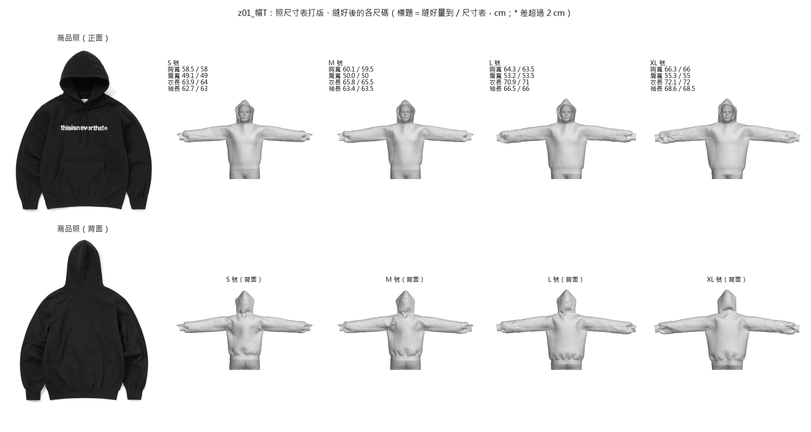
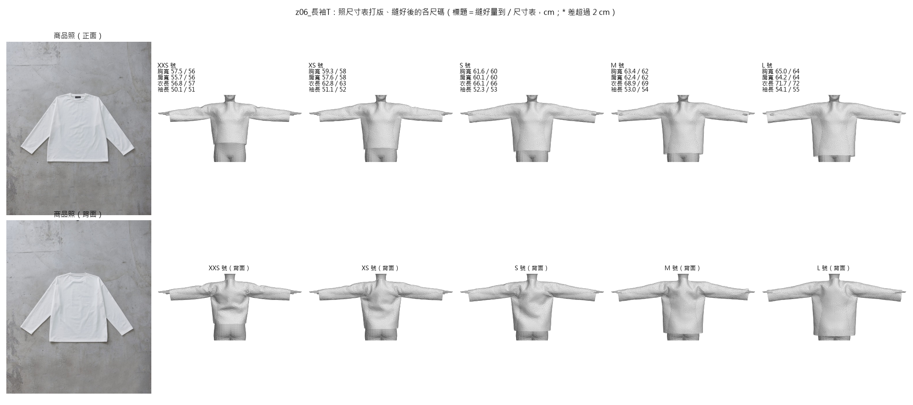
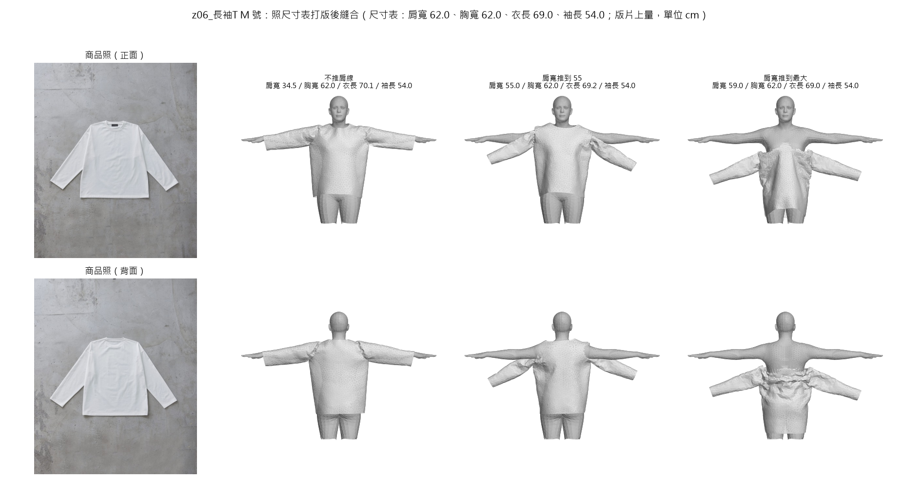
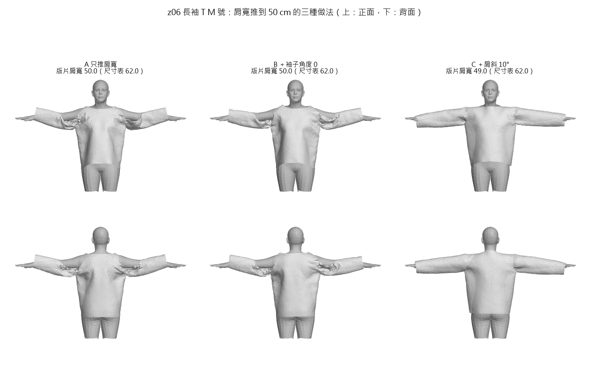
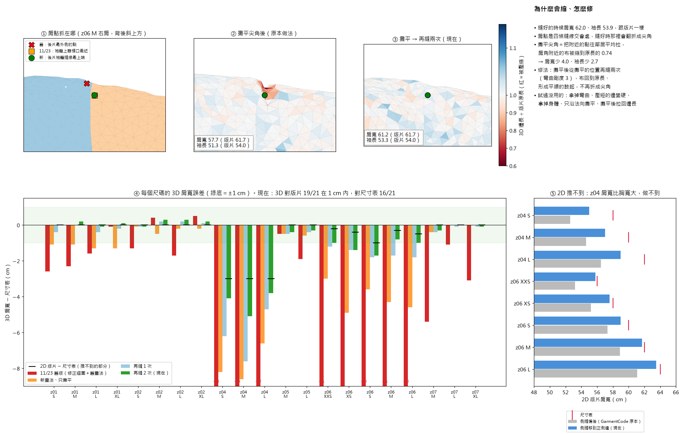
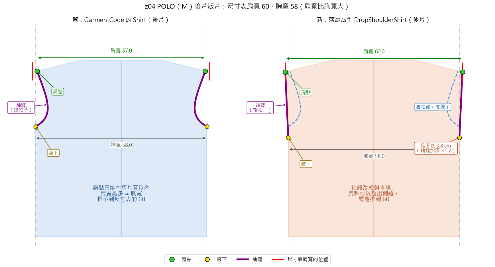
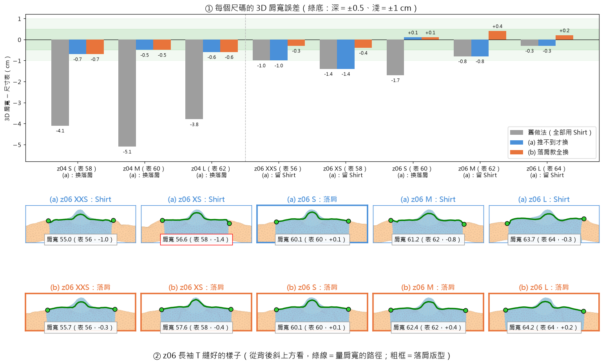
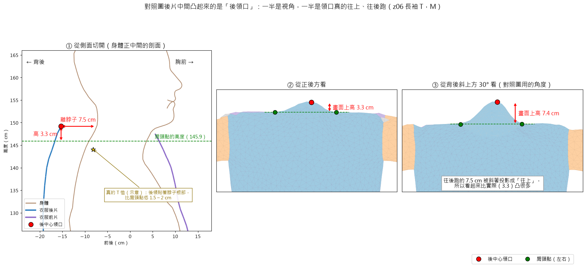
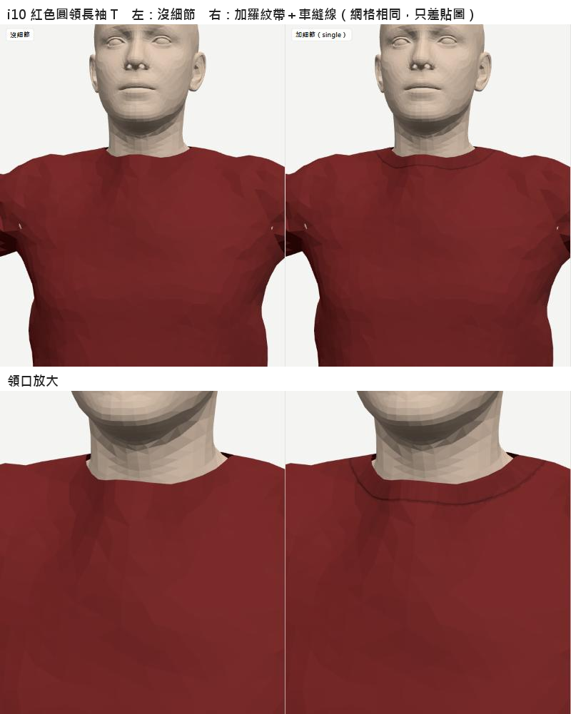
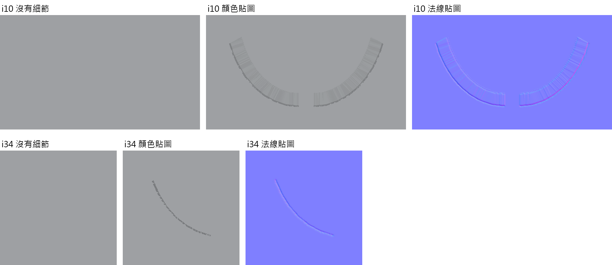

# 📐 照廠商尺寸表生成衣服

| 屬性 | 內容 |
|---|---|
| 📅 期間 | 2026-11-12 ～ 11-18；11-24 修肩寬、量法、拿掉修正迴圈；11-25 落肩版型 |
| 📂 程式 | `flows/size_chart/`（尺寸表）、`tools/texture/neck_trim.py`（領口貼圖） |
| 👕 樣本 | 7 件網路衣服 z01～z07，共 25 個尺碼 |
| 🟢 狀態 | 整批完成、已接進試穿頁（VTO_PROJ） |

---

# 一、生成步驟

> 💡 **分工**：AI 看照片只知道「款式」，不知道是哪個尺碼。所以**款式交給 AI，尺寸照尺寸表用數學換算**。

```
商品照 ─► ChatGarment ─► 款式 ─┐
                               ├─► ① 換算參數（2D 對準尺寸表）─► ② 縫合 ─► ③ 量 3D（只記錄）
尺寸表 ─► 尺寸.json ───────────┘                                                    │
                                                                                    ▼
                                                                         ⑤ 出圖、匯出、接進試穿頁
```

## 步驟 0：準備輸入
- **款式**：商品照 → ChatGarment（bf16）→ `results/chatgarment_ai/bf16_z/<衣服>/design_upper.yaml`。用的是領型、袖型、帽子、開襟這類設定。
- **尺寸**：廠商尺寸表整理成 `flows/size_chart/網路衣服_尺寸資料/<衣服>/尺寸.json`。每個尺碼有胸寬、肩寬、衣長、袖長，有的還有下襬圍。

## 步驟 1：尺寸表 → 版型參數
GarmentCode 的參數是「身體尺寸的倍數」，所以反推倍數：

| 項目 | GarmentCode 的定義 | 反推 |
|---|---|---|
| 胸寬 | 胸圍 = `shirt.width` × 身體胸圍 | `width` = 2 × 胸寬 ÷ 身體胸圍 |
| 衣長 | `shirt.length` × 腰線長 | `length` = 衣長 ÷ 腰線長 |
| 袖長 | `sleeve.length` × (手臂長 − 袖口) | `sleeve.length` = 袖長 ÷ (手臂長 − 袖口) |
| 下襬圍 | `shirt.flare` × width × 身體胸圍 | `flare` = 下襬圍 ÷ (width × 身體胸圍) |
| 肩寬 | 沒有參數 | 改打版用身體的 `shoulder_w`，做成落肩；落肩款上衣換成落肩版型 `DropShoulderShirt`（11-25，見二、問題 8） |
| 袖山抽皺 | `sleeve.connect_ruffle` | 落肩 1.0、一般肩 1.05（AI 給 1.11～1.18，像泡泡袖，見二、問題 7） |

換算完，先在 2D 版片上量一次。沒對到就再調，直到 2D 對上尺寸表。

## 步驟 2：縫到身體上
- 身體：SMPL-X 中性、T-pose、β 全 0。
- 每個尺碼各寫一份打版用身體 yaml（肩寬不同）。
- 頂點間距 2 cm；縫完把翻成尖角的三角形攤平。
- 攤平後**再縫兩次**（每次後再攤平），不然落肩的肩角會被攤平縮掉 3～5 cm（見二、問題 2）。

## 步驟 3：量縫好的 3D
沿著布面量最短距離，等於把那片布攤平後拿尺量（程式 `flows/size_chart/spec_measure.py`）：

| 項目 | 量法 |
|---|---|
| 胸寬 | 腋下往下 2.5 cm 一圈 ÷ 2 |
| 肩寬 | 左肩點 → 右肩點，只沿後片量 |
| 衣長 | 肩頸點 → 後片下襬，只沿後片量（＝後片攤平後垂直量） |
| 袖長 | 肩點 → 袖口邊，只沿袖子量（＝沿袖片上緣量） |
| 下襬圍 | 下襬一圈 |

- **肩點**：後片袖籠縫線的最上端，也就是肩線、前後袖籠、袖子上緣四條縫交會的點。直接用 GarmentCode 的縫線資料找，不靠 3D 位置猜。
- **肩頸點**：後片在版片座標上最高的點。
- **距離**：每條邊加 5 個點、三角形內兩兩相連再找最短路（平的版片上驗證誤差 < 0.5%）。之前用的 heat geodesic 在縫線網格上會短約 2 cm，不用了。
- 3D 照實量，**不拿版片數字補**；量不到尺寸表的就是 3D 衣服真的差那麼多。

## 步驟 4：~~差太多就修正~~（11-24 拿掉）
- 11-23 以前：縫好量 3D，差超過 1 cm 就把差距加回 2D 目標重縫，最多 3 次。
- **拿掉的原因**：那個迴圈是在補量法的偏差（肩點抓錯、距離算法短 2 cm、2D 漏算袖口），版片被越修越歪：z01 L 版片肩寬被推到 58.8（尺寸表 53.5）、z07 L 版片衣長 72.1（尺寸表 58.5）。
- 現在：**2D 版片＝尺寸表，縫一次**，3D 只量、記錄。

## 步驟 5：輸出
- 每個尺碼一個資料夾 `output/spec_to_pattern/_batch/<代號>/<尺碼>/`：`.obj`、`design.yaml`、`量測.json`、`segmentation.txt`。
- **出圖**（`spec_batch_figure.py`）：商品照和各尺碼正面、背面並排。
- **接進試穿頁**（`spec_batch_export.py`）：
  - 公分 → 公尺，移回 SMPL-X 座標。
  - 加固定點：頸肩一圈，帽 T 多加帽頂。
  - 複製到 VTO_PROJ，加進 `garments.json`，代號像 `z01S`。

```bash
.venv\Scripts\python flows\size_chart\spec_batch.py
.venv\Scripts\python flows\size_chart\spec_batch_figure.py
.venv\Scripts\python flows\size_chart\spec_batch_export.py C:/Users/User/Desktop/VTO_PROJ
```





## 📊 結果（25 個尺碼，縫好的 3D 對尺寸表，11-25 版：落肩款用落肩版型）

| 項目 | 有比的 | 1 cm 內 | 平均差 | 範圍 | 11-24 版（1 cm 內／平均差） |
|---|---|---|---|---|---|
| 肩寬 | 21 | **21** | 0.4 cm | −0.7～+0.9 | 16／1.0 cm |
| 衣長 | 20（不含比身體小的 z05、z07） | **20** | 0.2 cm | −0.5～+0.5 | 20／0.2 cm |
| 胸寬 | 20（同上） | 13 | 0.9 cm | +0.2～+1.6 | 18／0.7 cm |
| 袖長 | 25 | 18 | 0.8 cm | −1.7～+1.1 | 18／0.9 cm |

- **肩寬全部在 1 cm 內**：z04、z06 換成落肩版型後補上（問題 8）。
- **胸寬變差**：全部偏大，落肩版型偏大更多（+0.2～+1.6，舊的 +0.2～+1.3），1 cm 內從 18 掉到 13。原因還沒查：可能是腋下那一圈在 3D 微微鼓起，落肩版型前後片一樣寬也可能有關。
- **z02 襯衫**換落肩版型後肩寬偏寬 0.5～0.9（舊的 −0.1～+0.5），原因還沒查。
- **z01 帽 T** 這版多了下襬羅紋（6 cm、一圈＝胸圍 × 0.85），下襬圍和舊版不能直接比。
- **比身體小的 z05、z07**：胸寬被撐開 6～10 cm、z07 衣長短 2～5 cm（問題 3），真衣服穿上身也會這樣。

11-24 版的結果備份在 `output/spec_to_pattern/_batch_before_drop_1125`。

---

# 二、遇到的問題

## 🧩 問題 1：肩寬 → 要做成落肩

### 為什麼要做成落肩
尺寸表的肩寬比身體寬很多：

| | 肩寬 |
|---|---|
| GarmentCode 照身體打版（肩點在肩膀骨頭上） | 約 34.5 cm |
| z01 帽 T | 49～55 |
| z02 襯衫 | 50.5～55 |
| z04 POLO | 58～62 |
| z06 長袖 T | 56～64 |

尺寸表比身體寬 15～30 cm，每邊要超出肩膀 7～15 cm，肩點只能落在上臂上。這就是落肩的定義，這幾件實際上本來就是落肩款。
z05 開襟衫、z07 U 領 T 的肩寬（32～36.5）跟身體差不多，不用落肩。

```
一般肩：肩縫在肩膀上            落肩：肩縫垂到手臂上
    ┌──┐                           ┌──┐
 ───●  ●───  ← 袖子從這接       ───────●  ●───────
    │身│                           ↑ 衣身延伸到手臂上，袖子從這裡才接
```

### ❓ 不做落肩，硬把肩寬拉到尺寸表的數字會怎樣
z06 長袖 T 的 M 號（尺寸表肩寬 62），肩線斜度不變、只把肩寬推寬：



| 版本 | 結果 |
|---|---|
| 不推（34.5） | 正常，但肩寬差尺寸表 27 cm |
| 推到 55 | 袖子整條掉到手臂下面，手臂直接穿出來 |
| 推到 59 | 整件衣服滑到胸口以下，袖子和衣身全塌在腰上 |

> ⚠️ 衣服根本穿不上去，不只是不好看。

### ❓ 肩點不是就在肩膀最外側嗎，為什麼會往下跑
在**身體**上，肩點確實是肩膀最外側。問題出在**版片**怎麼畫肩線：
- GarmentCode 的肩線是一條直線，從領口照身體的肩斜（約 22°）往外往下畫，長度由肩寬決定。
- 肩寬照身體時，線剛好停在肩膀最外側。
- 肩寬推寬以後，線不會轉彎，繼續照 22° 往外往下延伸。超出肩膀的那段已經是手臂的位置，但線還在往下斜，所以版片的肩點比手臂還低。

```
          領口
            ╲  22°
             ╲
              ● 身體的肩點（肩膀最外側）
══════════════╲═══════════ 手臂（T-pose，水平）
               ╲
                ● 推寬後的肩點：在手臂下面
                ┃
                袖子從這裡接 → 手臂接不住，袖子往下掉
```

### ❓ 為什麼不做落肩就會掉下去
> 💡 縫合時**沒有開重力**。「掉下去」是被縫線拉下去，而且身體沒有地方擋住它。

**衣服靠兩個地方掛在 T-pose 身上**

| 支撐 | 怎麼撐 |
|---|---|
| ① 肩線壓在肩膀上 | 布蓋在肩膀頂端，往下的力被肩膀擋住 |
| ② 袖子套住手臂 | 手臂在袖筒裡面，袖子被手臂撐著 |

**縫合怎麼進行**
1. 版片先攤開，擺在身體周圍。
2. 縫線像橡皮筋，把要縫在一起的兩條邊越拉越近。
3. 身體只會把穿進去的布推出來，不會主動拉住布。

所以布最後停在哪，要看縫線把它拉到哪、途中有沒有被身體擋住。

**不放平時，兩個支撐都沒了**
```
 放平（C）                         不放平（推寬）
 領口                              領口
   ╲________●  肩點               ╲
 ══════════════ 手臂                ╲ ← 身體肩點
   布蓋在手臂上方，                ═══╲═══════ 手臂
   袖筒包住手臂                       ●  肩點在手臂下面
                                      ◯  袖籠也在手臂下面
```
- **② 沒了**：袖籠整圈在手臂下面，袖子縫成筒狀時包住的是手臂下面的空氣。
- **① 沒了**：肩線往外那段斜到手臂下面，懸空碰不到東西。
- **結果**：袖籠的縫線把衣身肩部往下、往袖籠拉，一路沒有東西擋。推得越寬，肩點越低，拉得越下面：55 是袖子掛在手臂下，59 是連領口一起被拉到胸口。
- engine 試穿時有重力，用這種版本只會掉得更嚴重。

### ✅ 怎麼救：肩線放平
同樣推到 50 cm，三種做法：



| 做法 | 改了什麼 | 結果 |
|---|---|---|
| A | 只推肩寬 | 腋下、肩膀一團皺，袖子接歪 |
| B | ＋袖子角度 0 | 還是皺，肩點本身就太低 |
| C | ＋肩斜改 10° | 肩線沿手臂上方延伸，袖筒包住手臂，穿得好 |

肩線放平後，推寬那段沿著手臂上方走，兩個支撐都回來了。

### ❓ 「推肩寬」推的是什麼
推的是**衣服的肩寬**，只有左右肩點往外移，胸寬、衣長、袖長照尺寸表不動：

| 版本 | 肩寬 | 胸寬 | 衣長 | 袖長 |
|---|---|---|---|---|
| 不推 | 34.5 | 62 | 70.1 | 54 |
| 推到 55 | 55 | 62 | 69.2 | 54 |
| 推到 59 | 59 | 62 | 69 | 54 |

GarmentCode 上衣沒有肩寬參數，肩點照打版用身體的 `shoulder_w` 算，所以做法是**騙它「這個人肩膀比較寬」**：
```
打版用的身體尺寸檔：shoulder_w 改大  →  GarmentCode 照「寬肩膀的人」畫版片，肩點畫得比較外面
縫合用的 3D 身體：不變（SMPL-X 中性，肩寬約 34.5）
```

> 💡 這就是肩點往下跑的根本原因：版片以為肩膀有 55 寬，照 22° 一路斜到 55；
> 實際身體肩膀只有 34.5，超出的那段是**水平的手臂**，不會跟著往下斜，所以版片的肩點落到手臂下面。

### ❓ 「肩斜改 10°」是什麼意思
**肩斜**：肩線（頸側點 → 肩點那條肩縫）跟水平線的夾角。
```
  頸側點
     ●
      ╲  ← 肩線
  ─────╲───── 水平線
     22° ●  肩點
```
- 角度大：肩線斜，像溜肩。
- 角度小：肩線平，像平肩。

GarmentCode 的肩斜是打版用身體的尺寸 `shoulder_incl`，SMPL-X 中性身體約 22°。
「改 10°」跟改肩寬是同一招：尺寸檔裡改成 10，騙它「這個人肩膀很平」，版片的肩線就畫得比較平。3D 身體一樣不變。

**為什麼 10° 就不會掉到手臂下**：從頸側點往外，每走 1 cm，肩線下降 tan(角度) cm。

| | 頸側點 → 肩點水平距離 | 22° 下降 | 10° 下降 |
|---|---|---|---|
| 真實肩膀（肩寬 34.5） | 約 9 cm | 約 3.7 cm（肩頭高度） | |
| 推到 50、肩斜不變 | 約 17 cm | 約 6.9 cm → 比肩頭低 3 cm 多，在手臂下 | |
| 推到 50、改 10° | 約 17 cm | | 約 3.0 cm → 跟肩頭差不多高，在手臂上 |

> 頸側點離中心約 8 cm 是估算，數字是大概的。

肩寬推寬，肩線走得遠，下降就多；角度調小，走得遠也降得少，肩點才停在手臂上方。
真的落肩衣服打版時，肩線本來就畫得比一般衣服平（要延伸到手臂上），所以這也比較接近真實落肩的版型。

**整批用的角度**：10° 是實驗值。整批時太平會讓 GarmentCode 報錯，所以從 12° 開始，依序試 12、14、16、18、20，挑最平、又推得到目標肩寬的：

| 衣服 | 肩斜 |
|---|---|
| z06 長袖 T | 12° |
| z01 帽 T | 14° |
| z04 POLO | 16° |

只有尺寸表肩寬比身體照常打版的肩寬多 3 cm 以上的尺碼才改肩斜，其他照原本 22°。

### 🚧 放平以後還剩的限制
- **放太平 GarmentCode 會報錯**，每件能放平的程度不同：z06 12°、帽 T 14°、POLO 16°。所以由平到斜逐一試，再用二分搜尋找最大肩寬。
- **肩點最遠只能推到後片邊緣**：GarmentCode 的側縫偏後面（後片寬＝身體背寬，比胸圍一半窄），z06 只推得到尺寸表 −2.5～−3。
  - ✅ 11-24：推不到的尺碼把打版用身體的 `back_width` 改成胸圍 ÷ 2（側縫移到正側邊，後片變寬），z06 全部推到尺寸表 0.5 內（S 號差 1）。3D 身體不變，跟改 `shoulder_w` 同一招。
  - ❌ z04 POLO 還是推不到（55／57／59 對尺寸表 58／60／62）：它的肩寬比胸寬還大，後片不可能比整件衣服寬。
  - ✅ 11-25：新增落肩版型 `DropShoulderShirt` 解決，見問題 8。
- ~~縫成 3D 會短：落肩那段在手臂上下垂、起皺，又少 5～8 cm~~ → **11-24 查清楚不是這樣**，見問題 2。

## 📏 問題 2：3D 肩寬量不準（11-16 第一次修、11-24 查清楚）



11-23 驗證時發現 3D 肩寬比版片少 4～7 cm，查下去是**三個問題疊在一起**：

| | 問題 | 影響 | 解法 |
|---|---|---|---|
| ① | **肩點抓錯**：用「後片在腋下以上最外側的點」，落肩款會抓到袖籠上比肩點低 2～3 cm 的地方 | 少 2～3 cm | 用 GarmentCode 的縫線資料：後片袖籠縫線最上端（`spec_measure.landmarks`） |
| ② | **距離算法偏短**：libigl 的 heat geodesic 在縫線網格上會短約 2 cm（58.3 量成 56.5） | 少約 2 cm | 自己寫精確最短距離（每條邊加點再找最短路，誤差 < 0.5%） |
| ③ | **攤平尖角把肩角縮掉**：落肩的肩點縫好時會翻折，`unfold` 把附近的點往鄰居平均拉，肩角附近的布被縮到 0.74 | 少 3～5 cm | 攤平後從攤平的位置**再縫兩次**（彎曲剛度 3），布變成平順的鼓起、不再折成尖角 |

**③ 是怎麼找到的**（z06 M）：

| 階段 | 肩寬（版片 61.7） | 袖長（版片 54.0） | 肩點附近邊長÷原長 |
|---|---|---|---|
| 縫好、還沒攤平 | 62.0 | 53.9 | 1.00 |
| 攤平（原本做法） | 57.7 | 51.3 | 0.74 |
| 攤平 → 再縫 → 攤平 | 60.3 | 52.7 | — |
| 再縫兩次 | **61.2** | **53.3** | — |

- 試過但沒用的：拿掉彎曲（一樣）、壓短的邊變更硬（更糟）、拿掉身體（更糟，−7.3）、攤平只沿法向移動（一樣）、攤平後把邊長拉回（馬上又翻折）。
- 照原長算，整件衣服除了肩點（338°，一個很淺的尖錐）其他點都是 360°，所以布的長度本身沒有矛盾，是「攤平」這一步造成的。
- 也順便發現：攤平時要用方向統一過的面（`sew.orient_faces`），不然襯衫、POLO 的翻領會被誤判成尖角、每次都被抹平。

**還有另外兩個推肩寬會碰到的**：
- **袖山抽皺**：AI 給的 `connect_ruffle` 是 1.11～1.18（袖山比袖籠長 11～18%，像泡泡袖），縫的時候多出來的布擠在肩角。改成落肩 1.0、一般肩 1.05（真的 T 恤約 0～7%）。
- **量法定案**：照實量真肩點 → 真肩點，不拿版片補。有試過「肩點內縮 3 cm 量再加回版片那段」（誤差 −0.6～+0.3），但那是拿版片掩蓋 3D 的問題，不採用；只在 `量測.json` 記成「肩角被壓（診斷）」。

## 👕 問題 3：衣服比身體小
| | 內容 |
|---|---|
| 現象 | z05 開襟衫、z07 U 領 T 胸寬 41～48，身體要約 50，縫上去一定被撐到 50～55 |
| 影響 | 修正迴圈一直想修胸寬，z05 修到當掉；挑最好那一次時也被這個做不到的數字拖著 |
| 解法 | 這種情況胸寬不修，也不算進挑最好的那一次（11-24 修正迴圈拿掉後不用再處理，`量測.json` 記「比身體小」） |
| 跟著短的 | 橫向被撐開，直向就縮：z07 衣長短 2～4 cm。真的衣服穿上身也是這樣 |

## 🎲 問題 4：縫合有隨機差
- 同一件縫三次，衣長在 58～61 之間跳，1 cm 已經接近極限。
- 修正最多 3 次，留最好的那一次。
- 11-24：這個跳動有一部分是 heat geodesic 不準造成的，改成精確距離、沿後片量以後，衣長 20 個尺碼全部在 0.5 cm 內。

## 🗂️ 問題 5：檔案被蓋掉
- 分區檔放在共用資料夾，被下一次縫合蓋掉，量出來對不上。
- 改成每個尺碼存自己的 `segmentation.txt`，重縫了 z04 M、z07 L。
- 11-24：量測點（肩點、肩頸點的頂點編號）也存進 `量測.json`，重量不再依賴縫合資料夾。

## 🚫 問題 6：版型本身做不到
| 狀況 | 衣服 | 原因 |
|---|---|---|
| 前後衣長不同（前 50 後 54） | z03 針織衫 | GarmentCode 前後片一樣長，取後片 |
| 方領被當成圓領 | z07 | AI 推論錯 |
| 口袋、前排釦、抽繩 | z01、z02、z05 | 版片沒有，要靠貼圖 |

## 🧵 問題 7：2D 袖長漏算袖口
- `spec_to_pattern.measure` 只找 `right` 開頭的袖口片，但袖口片叫 `sl_right_cuff_*`；就算找到，取的也是袖口圍不是長度。
- 有袖口的 6 件，2D 袖長一直少 5.4 cm，靠修正迴圈補回來。11-24 修好。

## 👕 問題 8：落肩版型 DropShoulderShirt（11-25）



**為什麼要新版型**：GarmentCode 的 Shirt 袖籠是往衣身裡挖的曲線，肩點只能在側縫以內，肩寬最多約等於胸寬。z04 POLO 尺寸表肩寬 60、胸寬 58，版片只推得到 57。

**新版型**（`flows/size_chart/drop_shoulder.py`，GarmentCode 原本的檔案沒改）：
- 袖籠改成從腋下到肩點的斜直線，肩點在延長的肩線上，可以超出側縫。
- 前後片一樣寬（側縫在正側邊），袖子接口是一條同長的直線（落肩的袖山是平的）。
- 領子、袖口、下襬羅紋沿用 GarmentCode。
- **不是 AI 判斷**：尺寸表肩寬比身體照常打版的肩寬多 3 cm 以上，就判定是落肩款，換這個版型（規則 (b)）。

**縫完還少 1 cm → 袖籠加深 ×1.2**：袖籠太短（腋下太高），袖子把肩膀往內拉，後片上緣被壓短 1.5%。試了 ×1.0／1.2／1.35，選 1.2。尺寸表沒有袖籠深，這是看 z04 M、z06 M 的結果挑的；真的落肩衣腋下本來就比較低。

**肩角自動多縫**：縫完量肩角被壓多少，超過 0.5 cm 就再縫一輪，最多 4 輪，留壓得最少的那次。

**換法 (a)／(b) 對照**（選 (b)）：



| 衣服 | 肩寬 3D − 尺寸表：舊（Shirt） | 落肩版型 (b) |
|---|---|---|
| z01 帽 T | −0.6～−0.1 | −0.3～+0.3 |
| z02 襯衫 | −0.1～+0.5 | +0.5～+0.9 |
| z04 POLO | −5.1～−3.8 | −0.7～−0.5 |
| z06 長袖 T | −1.7～−0.3 | −0.4～+0.4 |

- (a)＝Shirt 推不到（差 > 0.5）才換：z06 會有的尺碼換、有的不換，XS 留著 −1.4。
- (b)＝落肩款全換：同一件衣服各尺碼版型一致，16 碼都在 1 cm 內。
- 舊的 25 個尺碼版片用新量法重量，全部和原本一樣（沒改壞舊的）。

**還沒定的**：袖籠深 1.2 還沒定成程式預設（要 `set DROP_ARMHOLE_SCALE=1.2`）；z02 偏寬、胸寬偏大的原因。

## 🧥 後領口往上、往後跑（還沒解決）



z06 M 後中心領口比肩頸點高 3.3 cm、離脖子背面 7.5 cm（真的 T 恤後領貼著脖子根部、比肩頸點低 1.5～2 cm）。就是「圓領縫好後領口爬上脖子」，不影響肩寬（從肩點量）、衣長（從肩頸點量）。

## 🔧 小問題
- [x] libigl 打不開中文路徑 → 改英文路徑
- [x] GarmentCode 曲線取樣上下顛倒 → y 軸翻過去再翻回來
- [ ] 帽 T、襯衫 L／XL 超過 engine 的 4,000 頂點上限，還沒開鏡頭看會不會掉幀

---

# 三、領口細節貼圖

> 💡 **只改貼圖，網格完全不動。** 在 UV 貼圖上畫羅紋帶和車縫線，再輸出法線貼圖做出假的凹凸。
> 領子形狀不會變，圓領爬上脖子的問題要另外處理。

| 屬性 | 內容 |
|---|---|
| 📂 程式 | `tools/texture/neck_trim.py`（2026-11-14） |
| 🖼️ 示範 | i10 紅色圓領長袖 T、i34／h09 高領毛衣，`output/neck_trim_demo/viewer.html` |



> 左右兩件的網格一模一樣，右邊只多了顏色貼圖和法線貼圖，領口就多出一圈羅紋帶和車縫線。
> 高領（i34）也做了，但深藍色上接縫幾乎看不出來，所以這裡用紅色那件示範。



## 哪些領口要加（11-14 定的）
| 領型 | 畫什麼 |
|---|---|
| 一般領口（圓領等，沒有領子配件） | 沿領口一圈 2 cm 羅紋帶＋車縫線 |
| 高領（Turtle） | 領子和衣身交界畫接縫＋車縫；領子可選同布料或整片羅紋 |
| 帽 T、翻領（Polo、襯衫） | 不加 |
| V 領 | 先加，還沒定案 |

## 做法
1. **找線**
   - 圓領：GarmentCode 標了 `*_collar` 的頂點，找網格邊界中含最多這種頂點的那一圈。
   - 高領：分區檔中，一邊是領子、一邊是衣身的邊。
2. **畫到 UV 上**：每片版片畫成遮罩，算每個像素「離線多遠」和「沿線走到哪」，單位換成 cm。
3. **照距離決定畫什麼**：
   - 羅紋：一條間距 0.3 cm。
   - 車縫：虛線，一針 0.3 cm、間隔 0.12 cm，貼著接縫在衣身那一側。
4. **輸出**：
   - 顏色貼圖（灰色）。
   - 法線貼圖：由高度圖的梯度算。
   - 一張沒有細節的對照圖。

```bash
python tools\texture\neck_trim.py <縫好的.obj> <vertex_labels.yaml> <輸出資料夾> 2048 single <design_used.yaml>
```

## 相關但還沒解決
- [ ] **圓領 T 縫好後領口爬上脖子**：貼圖修不到，兩個修法還沒選：版片整體往下 6 cm（`anchor_y`），或併入 W5 的領口加寬。
- [ ] 11-14 的領型實驗（領寬加寬、高領領圈、收緊領圈）要不要併入正式流程。
- [ ] V 領要不要加羅紋帶。
