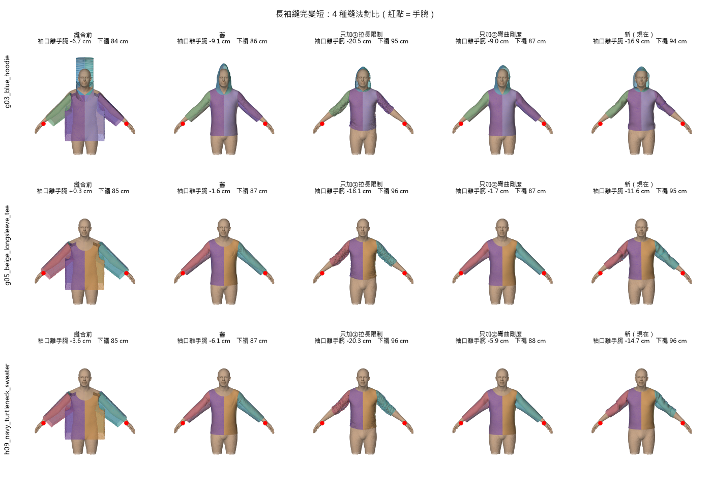
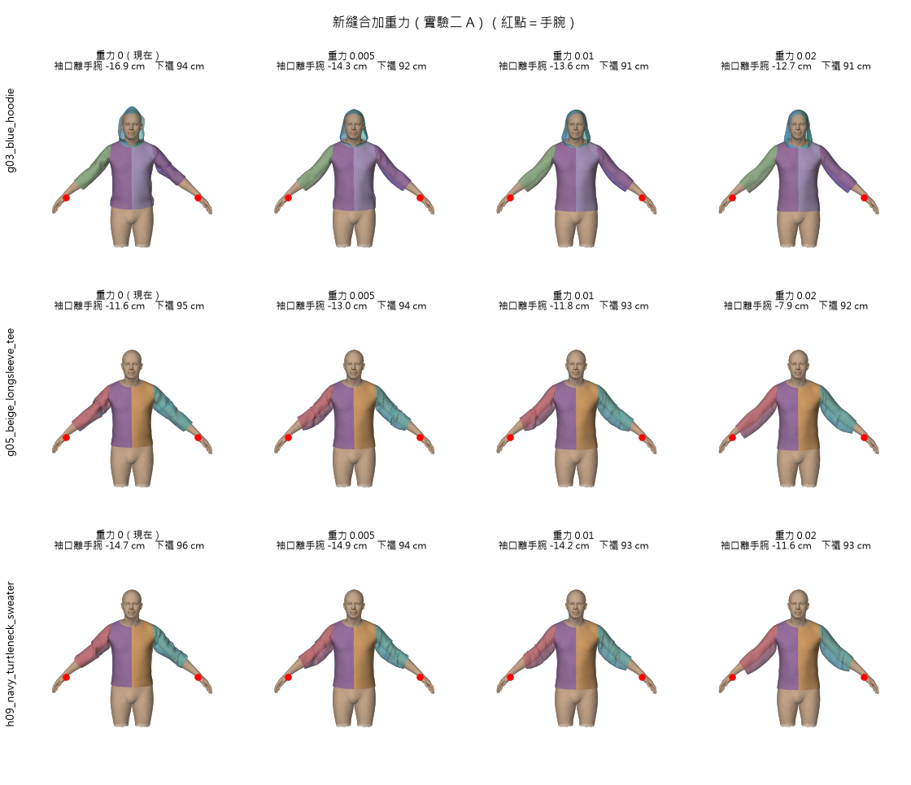

# 筆記：長袖偏短與袖口縮口

> 💡 **一句話**：長袖縫完比手腕短 10～17 cm。主因是**新縫合的「拉長限制」把整件衣服往上推，袖子還被擠短**，AI 把袖長估短只是次要原因。袖口縮口是 AI 有寫、參數卻沒選，加回來而且收皺 1.7 倍之後，縮口會包住手臂，袖子也長回 9 cm。
> 📅 2026-10-26～28
> 💻 程式：`tools/chatgarment/experiments/sleeve_sew_ablation.py`（實驗一）、`cuff_test.py`＋`cuff_figure.py`（縮口）、`sleeve_gravity_test.py`（實驗二 A）、`sleeve_ablation_figure.py`（畫圖）

---

## 一、怎麼量「袖子短多少」

- **身體：**GarmentCode 的 mean_male（A-pose），也就是縫衣服用的那個身體。
- **手臂軸：**用身體的手臂分區（`ggg_body_segmentation.json`）的頂點做主成分分析，得到手臂的方向。
- **手腕：**沿著手臂軸切片，手掌前面最細的地方。
- **袖口離手腕：**袖子頂點沿手臂軸最遠的那一點減去手腕的位置，取左右袖平均。負數＝還沒到手腕。

---

## 二、先看 AI 給的袖長

GarmentCode 的袖長公式（`sleeves.py:137`）：

```
袖子長度 ＝ sleeve.length × （手臂長 − 袖籠寬）
```

`sleeve.length` 的範圍是 0.1～1.15，**1 大約到手腕**。AI 給長袖的值是 0.78～0.92（第三批 24 件長袖是 0.80～0.97），全部小於 1。

| 衣服 | AI 袖長 | 縫合前 | 縫合後 | 縫合造成 |
|---|---|---|---|---|
| g03 藍帽 T | 0.78 | −6.7 | −16.9 | −10.2 |
| g04 白帽 T | 0.79 | −6.0 | −16.9 | −10.9 |
| g05 米色長袖 | 0.92 | **+0.3** | −11.6 | −11.8 |
| h05 襯衫 | 0.92 | −1.3 | −13.0 | −11.7 |
| h07 拉鍊帽 T | 0.81 | −5.5 | −13.8 | −8.3 |
| h08 開襟毛衣 | 0.84 | −3.4 | −11.9 | −8.5 |
| h09 高領毛衣 | 0.83 | −3.6 | −14.7 | −11.1 |
| h11 條紋長袖 | 0.86 | −3.1 | −15.5 | −12.4 |

（單位 cm，左右袖平均）

- **AI 估短：**縫合前離手腕 0～7 cm，帽 T 最短。
- **縫合：**又縮了 **8～12 cm**，占大部分。米色長袖縫合前剛好到手腕，縫完短了 12 cm。

---

## 三、實驗一：新縫合的哪個改動造成的

新縫合比舊縫合多兩個改動：① 拉長限制（邊被拉長超過 2% 時權重從 1 變 100）、② 彎曲剛度（bend 1）。同一件衣服用 4 種縫法各縫一次：

| 衣服 | 縫合前 | 舊 | 只加 ① | 只加 ② | 新（①＋②） |
|---|---|---|---|---|---|
| g03 藍帽 T | −6.7 | −9.1 | **−20.5** | −9.0 | −16.9 |
| g05 米色長袖 | +0.3 | −1.6 | **−18.1** | −1.7 | −11.6 |
| h09 高領毛衣 | −3.6 | −6.1 | **−20.3** | −5.9 | −14.7 |

| 縫法 | 領口被拉長 | 下襬離地 |
|---|---|---|
| 舊、只加 ② | 27～49% | 86～88 cm |
| 只加 ①、新 | **4～7%** | **約 95 cm（高 8～9 cm）** |



**結論：是 ① 拉長限制。** ② 彎曲剛度跟舊縫合幾乎一樣（我原本猜是 ②，猜錯了）。

**為什麼：**
- 舊縫合：領口和肩膀可以被撐大，像鬆的橡皮筋**往下滑**到肩膀較寬處，衣服掛得低。
- 新縫合：領口撐不大，像不能伸長的繩子。身體往外推它，它只能**往脖子細的那頭滑**，整件衣服被往上推，袖子跟著上去，還被擠皺：
  - 袖子上端往上 4～5 cm；
  - 約一成的袖子邊被壓到原長 9 成以下（新縫合只限制「拉長」，「壓短」沒有限制）。
- 縫合裡**沒有重力**，沒有東西把衣服往下拉。

衣長校正之前量到的「縫完會往上 9～10 cm」也是同一個原因。軀幹已經用重縫補回來了，袖子沒有補，所以袖子特別短。

---

## 四、袖口縮口

### 問題：AI 有寫，參數沒選

長袖的 AI 描述幾乎都寫 **"ribbed cuffs"**（羅紋袖口），但參數 `sleeve.cuff.type` 全部是無。這跟領型一樣，是描述和參數互相矛盾。

第三批 50 件也一樣：**描述有寫袖口的 20 件，袖口參數一件都沒有**。只有 2 件有袖口參數，偏偏是描述沒寫的 i16、i25（深 V 短袖、方領背心）。

### GarmentCode 的袖口參數

| 參數 | 意思 |
|---|---|
| `cuff.type` | `CuffBand` 羅紋縮口、`CuffSkirt` 荷葉邊、`CuffBandSkirt` 兩種都有、無 |
| `cuff.cuff_len` | 袖口長度（× 手臂長），預設 0.1 約 5.7 cm。**會從袖子本體扣掉，總袖長不變** |
| `cuff.top_ruffle` | 袖子末端收皺幾倍。**縮口一圈 ＝ 袖子末端一圈 ÷ top_ruffle**（最少手腕一圈） |

### 試驗：藍帽 T（g03）

沿用最新的款式（衣長、領深都校正過），只改袖口，縫法相同（新縫合），量左袖：

| 版本 | 袖口一圈 | 該處手臂一圈 | 袖口離手腕 |
|---|---|---|---|
| 原本（沒有縮口） | 32 cm | 27 cm | −19.1 cm |
| 加縮口，top_ruffle 1（AI 的值） | 33 cm | 25 cm | −13.7 cm |
| **加縮口，top_ruffle 1.7** | **22 cm** | **22 cm** | **−9.6 cm** |

圖：`output/chatgarment/袖口縮口_g03.png`（含商品照，不放進 repo）

- **top_ruffle 1 沒用：**完全不收皺，縮口跟袖子末端一樣寬，只是多接一段同樣寬的布，沒包住手臂。
- **top_ruffle 1.7：**縮口一圈剛好等於手臂粗細，**包住了**。縮口卡在手臂上，袖子比較不會被往上推，**長回 9 cm**。
- **還不夠的地方：**
  - 袖子末端看不出收皺，只是變細。可能是彎曲剛度把皺褶抹平了，或網格太粗。
  - 縮口還在前臂中段。
  - 縮口完全貼緊沒有空隙，紀泓宇要求袖子離手臂至少約 18 mm，之後可能要放鬆到 1.5 左右。
- **看起來跟袖子一樣薄：**網格只有一層面，沒有厚度，羅紋的厚度和直紋做不出來。要靠貼圖（直條紋、法線貼圖）或物理端處理。

---

## 五、實驗二 A：新縫合加重力

`sew.py` 本來就有 `gravity` 參數（每一輪每個點往下拉一點），預設關著。

- **10-17 試過：**只加重力、沒有拉長限制時，布會被往下拉長（領口 +44%），所以當時判斷「不好用」。
- **這次的想法：**現在有拉長限制，布不能變長，重力只能讓整件**往下滑**。

同實驗一的 3 件，重力 0／0.005／0.01／0.02 各縫一次：

| 衣服 | 重力 | 袖口離手腕 | 下襬離地 | 領口拉長 | 穿進身體 |
|---|---|---|---|---|---|
| g03 藍帽 T | 0（現在） | −16.9 | 94.4 | 5.0% | 0% |
| | 0.005 | −14.3 | 92.3 | 5.0% | 0% |
| | 0.01 | −13.6 | 91.2 | 4.8% | 0% |
| | **0.02** | **−12.7** | **90.6** | 5.3% | 0% |
| g05 米色長袖 | 0（現在） | −11.6 | 95.3 | 6.7% | 0% |
| | 0.005 | −13.0 | 93.9 | 6.6% | 0% |
| | 0.01 | −11.8 | 93.1 | 6.6% | 0% |
| | **0.02** | **−7.9** | **92.4** | 5.4% | 0% |
| h09 高領毛衣 | 0（現在） | −14.7 | 95.8 | 6.0% | 0% |
| | 0.005 | −14.9 | 94.1 | 5.8% | 0% |
| | 0.01 | −14.2 | 93.4 | 5.6% | 0% |
| | **0.02** | **−11.6** | **92.6** | 4.8% | 0% |

（單位 cm）



**結論：**
- **有幫助但不夠：**重力 0.02 讓袖子拉回 3～4 cm、下襬往下 3～4 cm。舊縫合是 −2～−9 cm，還差很多。
- **副作用都沒有：**領口沒被撐大（4.8～6.7%），也沒穿進身體。這跟 10-17 只加重力時領口 +44% 不同，因為現在有拉長限制。
- **小重力（0.005、0.01）對袖子幾乎沒效：**有時反而短一點，只有下襬穩定往下。袖子要到 0.02 才明顯變長。
- **還可以試：**更大的重力（0.05）、限制「壓短」、重力搭配縮口（縮口自己就讓袖子長回 9 cm）。

---

## 六、目前的結論與下一步

| 原因 | 影響 | 處理 |
|---|---|---|
| 新縫合的拉長限制把衣服往上推、袖子被擠短 | 8～12 cm | 壓短限制 2%（見七），已加進交付流程；整件上滑還沒解決 |
| AI 沒選袖口縮口 | 外觀不對、袖子少 9 cm | 規則已寫進 `to_design.py` 的 `fix_cuff`：長袖、描述有 cuffs → `CuffBand`、top_ruffle 1.7 |
| AI 袖長估短 | 0～7 cm（帽 T 最多） | 等上面兩個處理完再看；可能像衣長一樣加規則（長袖至少到手腕） |

---

## 七、2026-10-29：換 SMPL-X 中性身體、壓短限制

### 尺寸檔要用新格式

GarmentCode 的尺寸檔有兩種量法：
- `f_smpl_template.yaml`：人手量的舊量法，手臂長 80 cm。
- `mean_all`／`mean_male`／`mean_female`：GarmentCodeData 程式自動量的，手臂長 54／56.8／51.6 cm。**ChatGarment 學的是這種**。

用舊的女性模板，袖子會長 14～27 cm。AI 輸出的是比例，所以換身體不用重新推論，款式修正規則也都通用；只有領深、衣長要照新身體重算。
交付身體改成 **SMPL-X 中性、θ=0、β 全 0＋mean_all 尺寸檔**（身高 172.0 cm，和 SMPL-X 中性 172.1 cm 幾乎一樣）。

### 壓短限制

`sew.py` 新增 `compress_limit`：邊被壓到短於原長 (1 − 限制) 時，權重也改成 `stretch_weight`（100），跟拉長限制同一套。

| 衣服（T-pose、中性） | 新縫合 | ＋壓短限制 2% | ＋縮口＋壓短限制 2% |
|---|---|---|---|
| g03 藍帽 T | −18 | −12.1 | −11.2 |
| g05 米色長袖 | −8.6 | −2.6 | −3.9 |

（袖口離手腕，cm）

- 壓短限制讓袖子長回約 6 cm，領口沒有被撐大。
- 縮口加上去長度差不多，但外觀對了。g03 有 1.3% 頂點穿進手腕，縮口可能太緊（之後考慮 top_ruffle 1.5）。
- **還沒解決：整件上滑。**領口一圈撐不開，身體在脖子到肩膀的斜坡往外推時有往上的分量，縫合又沒有重力，下襬比縫合前高約 10 cm。衣長校正會量「縫合往上提」多少再把衣長加長補回來，所以下襬最後位置是對的；肩膀、袖子的位置還是偏高。

### 交付流程：`export_neutral.py`

一批 AI 結果 → 款式修正（含縮口）→ 領深校正 → 先縫一次量往上提 → 衣長校正（差 1 cm 以上再修一次）→ 新縫合＋壓短限制 2% → 匯出。

- 頂點間距 2 cm（約 2,000～4,000 頂點）、公尺、**SMPL-X 原始座標**（和 engine 的身體同一個座標，不用再對齊肩膀）。
- 固定點 `neck_shoulder_band` 照 `engine/cloth/attachment.py` 的規則：最近身體面三個角的 SMPL-X 蒙皮主導關節都是頸或左右鎖骨，且離身體 1 cm 內。
- 每件附 `fix.json`（衣長、領口校正紀錄）、`design_used.yaml`，`_pins.json` 的 `check` 有穿進身體 %、下襬離地。
